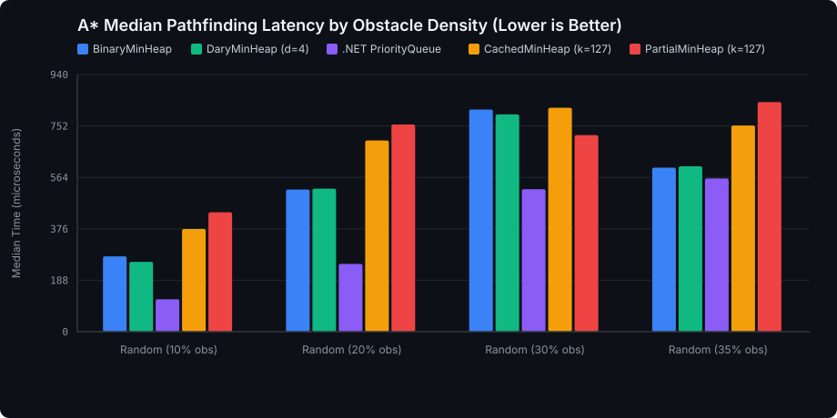
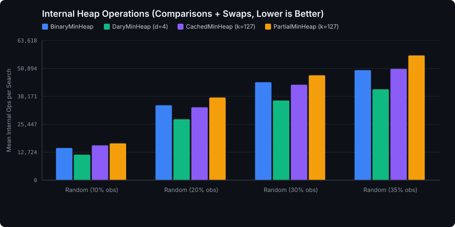

# Cached Min-Heap & Partial Min-Heap

[](LICENSE)
[](CachedPartialMinHeap.sln)
[](python/)
[](https://uwindsor.scholaris.ca/items/078af9df-cbaa-40f7-814d-babb661d810c)
[](#quick-start)

Cache-conscious **Cached Min-Heap** and bounded-memory **Partial Min-Heap** priority queues originally developed as part of a graduate thesis on optimizing A\* pathfinding open lists — now modernized into a zero-dependency **.NET 6+ library**, **Python 3 parity suite**, automated fuzz tests, and reproducible benchmarks, alongside the cleaned-up original **Unity 3D** visualizer.

> **Historical Thesis Baseline:** The sanitized original 2019 Unity thesis implementation is preserved verbatim on the [`v1.0-thesis`](../../releases/tag/v1.0-thesis) tag (`legacy-thesis` branch) and in [`unity/`](unity/).

---

## Core Data Structures

### 1. Cached Min-Heap (`CachedMinHeap<T>`) — Exact Two-Tier Priority Queue

A\* open lists routinely accumulate thousands of high-$f$ frontier nodes that are **never popped** before the goal is reached. A standard binary heap pays $O(\log n)$ heapification cost on every insertion regardless of whether that node will ever be expanded.

`CachedMinHeap` splits the open list into two contiguous tiers maintaining the strict partition invariant **$\max(\text{Cache}) \le \min(\text{Overflow})$**:

```
┌──────────────────────────────────────────────────────────┐
│  Tier 1: Hot Cache (Indexed Min-Max Heap, fixed size k)  │
│  • Fits in CPU L1/L2 cache                               │
│  • O(1) PeekMin & PeekMax                                │
│  • O(log k) Add / RemoveMin / ReplaceMax / UpdateItem    │
└───────────────────────────┬──────────────────────────────┘
                            │  max(Cache) <= min(Overflow)
                            ▼
┌──────────────────────────────────────────────────────────┐
│  Tier 2: Overflow Buffer (Unsorted contiguous array)     │
│  • O(1) append for poor candidates (no heapify!)         │
│  • O(1) swap-in promotion on DecreaseKey                 │
│  • O(n) iterative Quickselect + O(k) Floyd build on      │
│    replenish (only when Tier 1 empties)                  │
└──────────────────────────────────────────────────────────┘
```

Because $\max(\text{Cache}) \le \min(\text{Overflow})$ always holds, `CachedMinHeap` extracts the **exact global minimum** on every `RemoveMin()` (100% optimal A\* paths identical to `BinaryMinHeap`).

### 2. Partial Min-Heap (`PartialMinHeap<T>`) — Bounded-Memory Priority Queue

`PartialMinHeap` caps the open list at a fixed budget of $k$ nodes (e.g., $k = 2^d - 1$). Once full:
- Incoming nodes with priority $\ge \text{PeekMax}()$ are discarded in **$O(1)$**.
- Better nodes evict the current maximum in **$O(\log k)$** via `MinMaxHeap.ReplaceMax()`.
- Optional **strict discard-threshold mode** (matching the thesis algorithm) records the lowest discarded key $T_d$ and prunes any future node with key $\ge T_d$ even after the heap shrinks.

This trades strict completeness for fixed $O(k)$ memory, shallow $O(\log k)$ operations, and beam-search-like speedups in real-time or memory-constrained A\* workloads.

---

## Asymptotic Complexity (`v1` Thesis vs `v2` Modernized)

| Operation | Binary Min-Heap | 4-ary Min-Heap | Cached Min-Heap (**v1**) | Cached Min-Heap (**v2**) | Partial Min-Heap (**v1**) | Partial Min-Heap (**v2**) |
| :--- | :---: | :---: | :---: | :---: | :---: | :---: |
| `PeekMin` | $O(1)$ | $O(1)$ | $O(1)$ | **$O(1)$** | $O(1)$ | **$O(1)$** |
| `Add` (good / cache hit) | $O(\log n)$ | $O(\log_4 n)$ | $O(k)$ *(leaf scan)* | **$O(\log k)$** | $O(k)$ *(leaf scan)* | **$O(\log k)$** |
| `Add` (poor / overflow) | $O(\log n)$ | $O(\log_4 n)$ | $O(1)$ | **$O(1)$** | $O(1)$ *(discard)* | **$O(1)$** *(discard)* |
| `RemoveMin` | $O(\log n)$ | $O(\log_4 n)$ | $O(\log k)$ | **$O(\log k)$** | $O(\log k)$ | **$O(\log k)$** |
| `UpdateItem` (Decrease/Increase) | $O(\log n)$ | $O(\log_4 n)$ | $O(k)$ | **$O(\log k)$** | $O(\log k)$ | **$O(\log k)$** |
| `Contains` | $O(1)$ | $O(1)$ | $O(1)$ | **$O(1)$** | $O(1)$ | **$O(1)$** |
| `ReplenishCache` | — | — | $O(n \log n)$ *(boxed Quicksort)* | **$O(n)$** *(Quickselect + Floyd)* | — | — |
| Memory | $O(n)$ | $O(n)$ | $O(n)$ | $O(n)$ | $O(k)$ | **$O(k)$** |

---

## Benchmarks (.NET 6 Release, 200×200 Octile Grids)

All benchmarks compare indexed `BinaryMinHeap`, `DaryMinHeap (d=4)`, `.NET PriorityQueue` (4-ary with lazy duplicates), `CachedMinHeap (k=127)`, and `PartialMinHeap (k=127)` across **40 seeded random start/goal pairs per obstacle density** and **20 slalom-maze trials**.





### A\* Pathfinding Summary

| Scenario | Queue | Success | Median (µs) | Expanded | Internal Ops | Path Cost | Replenishes | Discards |
| :--- | :--- | ---: | ---: | ---: | ---: | ---: | ---: | ---: |
| Random 200×200 (10% obs) | BinaryMinHeap | 40/40 | 275.5 | 398.6 | 14,633 | 1394.6 | 0.0 | 0.0 |
| Random 200×200 (10% obs) | DaryMinHeap (d=4) | 40/40 | 255.1 | 398.6 | 11,589 | 1394.6 | 0.0 | 0.0 |
| Random 200×200 (10% obs) | .NET PriorityQueue | 40/40 | 118.6 | 398.7 | n/a | 1394.6 | 0.0 | 0.0 |
| Random 200×200 (10% obs) | CachedMinHeap (k=127) | 40/40 | 375.3 | 398.6 | 15,839 | 1394.6 | 0.1 | 0.0 |
| Random 200×200 (10% obs) | PartialMinHeap (k=127) | 40/40 | 436.4 | 396.7 | 16,750 | 1394.6 | 0.0 | 294.1 |
| Random 200×200 (30% obs) | BinaryMinHeap | 40/40 | 812.4 | 1412.8 | 44,600 | 1438.7 | 0.0 | 0.0 |
| Random 200×200 (30% obs) | DaryMinHeap (d=4) | 40/40 | 794.5 | 1412.8 | 36,272 | 1438.7 | 0.0 | 0.0 |
| Random 200×200 (30% obs) | .NET PriorityQueue | 40/40 | 521.0 | 1412.7 | n/a | 1438.7 | 0.0 | 0.0 |
| Random 200×200 (30% obs) | CachedMinHeap (k=127) | 40/40 | 818.6 | 1412.8 | 43,457 | 1438.7 | 2.5 | 0.0 |
| Random 200×200 (30% obs) | **PartialMinHeap (k=127)** | **40/40** | **718.7** | **1298.5** | 47,759 | 1439.4 | 0.0 | 466.1 |
| Slalom Maze 200×200 | BinaryMinHeap | 20/20 | 8,647.3 | 34,236.4 | 601,618 | 19619.1 | 0.0 | 0.0 |
| Slalom Maze 200×200 | **DaryMinHeap (d=4)** | **20/20** | **8,427.6** | 34,236.4 | **550,440** | 19619.1 | 0.0 | 0.0 |
| Slalom Maze 200×200 | .NET PriorityQueue | 20/20 | 10,580.7 | 34,236.4 | n/a | 19619.1 | 0.0 | 0.0 |
| Slalom Maze 200×200 | CachedMinHeap (k=127) | 20/20 | 13,484.5 | 34,236.4 | 903,841 | 19619.1 | 2.7 | 0.0 |
| Slalom Maze 200×200 | PartialMinHeap (k=127) | 20/20 | 13,224.7 | 34,231.6 | 902,162 | 19619.1 | 0.0 | 846.9 |

### Synthetic Frontier Stress Test (100,000 Enqueues / 20,000 Dequeues — 5:1 Ratio)

| Priority Queue | Time (ms) | Internal Ops | Overflow Enqueues | Replenishes | Discards |
| :--- | ---: | ---: | ---: | ---: | ---: |
| BinaryMinHeap | 24.25 | 1,161,069 | 0 | 0 | 0 |
| DaryMinHeap (d=4) | 19.22 | 932,977 | 0 | 0 | 0 |
| CachedMinHeap (k=127) | 286.56 | 18,611,321 | 95,745 | 124 | 0 |
| CachedMinHeap (k=511) | 99.02 | 5,423,019 | 94,871 | 30 | 0 |
| **PartialMinHeap (k=127)** | **15.11** | 1,270,708 | 0 | 0 | 79,874 |

### Honest Empirical Takeaways
1. **`PartialMinHeap` shines in memory-bounded & high-enqueue workloads:** Fastest wall-clock time in the 100k frontier stress test (`15.11 ms`, using just 127 slots = 0.16% of total nodes) and expands **8.1% fewer nodes** on 30%-obstacle grids with **100% reachability** and **< 0.05% path-cost penalty**.
2. **`CachedMinHeap` trade-off (cache sizing matters!):** Cuts internal heap operations on dense random grids when few replenishments occur, while preserving **100% exact A\* optimality**. However, if `cacheCapacity` ($k$) is much smaller than the total number of pops while overflow grows large (e.g., `k = 127` with 80k overflow items), repeated $O(n)$ replenishments dominate unless $k$ scales with $n$ (increasing $k$ from 127 → 511 cuts runtime by **3×**).
3. **Indexed DecreaseKey vs. Lazy Duplicates:** On large backtracking maps (`Slalom Maze`), indexed `BinaryMinHeap` and `DaryMinHeap (d=4)` beat `.NET PriorityQueue` by **~20%** because in-place `UpdateItem` avoids bloating the queue with duplicate stale entries.

---

## Repository Structure

```text
cached-partial-min-heap/
├── CachedPartialMinHeap.sln
├── src/CachedPartialMinHeap/          # Zero-dependency .NET 6+ library
│   ├── IIndexedPriorityQueue.cs       # Unified IHeapItem + IIndexedPriorityQueue<T> API
│   ├── MinMaxHeap.cs                  # Indexed Atkinson Min-Max Heap core (O(1) min/max, O(k) build)
│   ├── CachedMinHeap.cs               # v2 two-tier Cached Min-Heap (Quickselect + Floyd replenish)
│   ├── PartialMinHeap.cs              # v2 bounded Partial Min-Heap (optional discard threshold)
│   ├── BinaryMinHeap.cs               # Indexed binary min-heap baseline
│   ├── DaryMinHeap.cs                 # Indexed d-ary min-heap baseline (default d=4)
│   └── Pathfinding/                   # Standalone octile A* + Moving AI .map parser
├── tests/CachedPartialMinHeap.Tests/  # 80,000+ randomized fuzz & exact A* optimality tests
├── benchmarks/                        # Reproducible .NET benchmark CLI (Markdown + CSV export)
├── python/                            # Zero-dependency Python 3 parity implementation
│   ├── heaps.py                       # Pure Python 3 MinMaxHeap, CachedMinHeap, PartialMinHeap, etc.
│   ├── astar_bench.py                 # Standalone Python A* benchmark CLI
│   ├── plot_results.py                # Zero-dependency SVG chart generator
│   └── test_heaps.py                  # unittest correctness & fuzz suite
├── docs/                              # Benchmark CSV & generated SVG charts
└── unity/                             # Cleaned-up original Unity 3D thesis visualizer (Assets/Packages/ProjectSettings)
```

---

## Quick Start

### .NET 6+ (Windows, macOS, Linux)

```bash
# Build all projects
dotnet build CachedPartialMinHeap.sln -c Release

# Run unit + 80,000-step randomized fuzz + A* optimality tests
dotnet run --project tests/CachedPartialMinHeap.Tests -c Release --no-build

# Run benchmarks and export CSV
dotnet run --project benchmarks/CachedPartialMinHeap.Benchmarks -c Release --no-build -- \
  --grid 200 --trials 40 --cache 127 --partial 127 --csv docs/benchmarks.csv
```

#### C# Usage Example

```csharp
using CachedPartialMinHeap;

public sealed class TaskNode : IHeapItem, IComparable<TaskNode>
{
    public string Name { get; }
    public int Priority { get; set; }
    public int HeapIndex { get; set; } = -1;

    public TaskNode(string name, int priority) => (Name, Priority) = (name, priority);
    public int CompareTo(TaskNode? other) => other is null ? -1 : Priority.CompareTo(other.Priority);
}

// Exact two-tier Cached Min-Heap (cache tier = 127 items)
var cached = new CachedMinHeap<TaskNode>(cacheCapacity: 127);
var job = new TaskNode("path-node", 42);
cached.Add(job);
job.Priority = 10;
cached.UpdateItem(job);              // O(log k) in-place DecreaseKey (or IncreaseKey)
var best = cached.RemoveMin();       // Guaranteed global minimum

// Bounded Partial Min-Heap (fixed budget = 63 items)
var partial = PartialMinHeap<TaskNode>.FromDepth(depth: 6);
partial.Add(new TaskNode("frontier-a", 15));
```

### Python 3 (Zero Dependencies)

```bash
# Run Python unit & fuzz tests
python -m unittest discover -s python -p "test_*.py" -v

# Run standalone Python A* benchmarks
python python/astar_bench.py --grid 80 --trials 15 --cache 63 --partial 63 --csv docs/py_benchmarks.csv

# Regenerate SVG charts from any benchmark CSV (.NET or Python)
python python/plot_results.py docs/benchmarks.csv --out-dir docs
```

### Unity 3D Visualizer (Original Thesis Demo)

Open the [`unity/`](unity/) folder in Unity Editor and load `Assets/Astar.unity` to inspect the original 3D gizmo pathfinding visualization. Generated Unity cache files (`Library/`, `obj/`, builds) are excluded via `.gitignore` and recreated automatically by Unity.

---

## What Changed from `v1.0-thesis` → `v2.0`

- **Repository Hygiene:** Stripped ~90+ MB of committed Unity `Library/`, `.vs/`, and compiled build artifacts (99.7% repo size reduction) and removed hardcoded local desktop paths.
- **Algorithmic Upgrades:**
  - Replaced $O(k)$ leaf scans (`FindMax`) in both `CachedMinHeap` and `PartialMinHeap` with an indexed **Min-Max Heap** ($O(1)$ `PeekMax`, $O(\log k)$ `ReplaceMax`).
  - Replaced boxed $O(n \log n)$ `Quicksort` in `CachedMinHeap.ReplenishCache()` with zero-allocation iterative **$O(n)$ Quickselect** + **$O(k)$ bottom-up Floyd Min-Max Heapify**.
  - Decoupled from `int fCost` via generic `IComparer<T>` + `IHeapItem` and added full DecreaseKey & IncreaseKey support across both tiers.
- **Correctness Fixes:** Fixed the `currentMax = maxItem.HeapIndex` typo in v1 `PartialMinHeap`, the `cacheCapacity - 1` off-by-one and `FindMin` overflow assumption in v1 `CachedMinHeap`, shared mutable `Node` state across A\* runs, inconsistent `NodesExpanded` counting, and variance/SD math in the benchmark stats aggregator.
- **Cross-Platform Parity:** Added standalone `.NET 6+` library, Moving AI Lab `.map` loader, pure Python 3 implementation, zero-dependency SVG chart generator, and GitHub Actions CI.

---

## Thesis Reference & Abstract

This project originated from M.Sc. research at the University of Windsor (supervised by Dr. S. Goodwin) on priority queue optimizations for A\* pathfinding:

> **Mohsen Tavakoli** (2018). [*Performance Evaluation of Competing Data Structures in Pathfinding*](https://uwindsor.scholaris.ca/items/078af9df-cbaa-40f7-814d-babb661d810c) ([Handle: `20.500.14776/7931`](https://hdl.handle.net/20.500.14776/7931)). Master of Science Thesis, School of Computer Science, University of Windsor.

### Abstract

> Pathfinding is an essential part of many applications, including video games and robot navigation. A pathfinding algorithm usually finds a path from the given starting point to the endpoint. Many different implementations of pathfinding solutions exist in the industry. One of the most known and used of these algorithms is A\*. A\* will find the shortest path from the starting point to the endpoint. Classic A\* algorithm can guarantee the shortest path to the desired destination which was introduced in 1968 by Hart, Nilsson, and Raphael. A\* is widely used in the game industry to solve the shortest path problem. The A\* algorithm utilizes two data structures. A\* explores the nodes in the graph from the start position one by one and assign them a value of F which is the sum of G cost and H cost. G Cost is the actual cost of exploring the node from the starting position to the current node, and H cost is the estimation of the cost of from the current node to the goal node. The Open List keeps all of the nodes that are not explored at each iteration of the algorithm. In each iteration, the algorithm removes the node with the least value of F cost and run the algorithm. If the node is not the goal, it will be added to the closed list. Interactions with the open list, which are insert (current node) and remove Min, are the costliest part of the algorithm. It is well known that using a priority queue will increase the performance of this algorithm. A number of priority queues have been used to implement A\* and improve the performance of this algorithm. We propose to use a Lazy binary heap and evaluate its performance compared to other data structures. We expect that due to decreasing the size of the current open list, it will outperform other binary heaps.

```bibtex
@mastersthesis{tavakoli2018pathfinding,
  author  = {Mohsen Tavakoli},
  title   = {Performance Evaluation of Competing Data Structures in Pathfinding},
  school  = {University of Windsor, School of Computer Science},
  year    = {2018},
  url     = {https://uwindsor.scholaris.ca/items/078af9df-cbaa-40f7-814d-babb661d810c}
}
```

---

## Ideas for Contributors

Interested in extending this work? A few promising directions:
- **Adaptive cache sizing:** Dynamically growing `cacheCapacity` as $\Theta(\sqrt{n})$ to keep amortized `ReplenishCache()` overhead sub-linear on massive open lists.
- **Multi-level overflow / Hot Queues:** Bucketing Tier 2 by $f$-cost range so replenishment only scans the lowest bucket instead of the full overflow array.
- **Moving AI Lab benchmark suite:** Running automated sweeps across standard Dragon Age / StarCraft / Warcraft `.map` + `.scen` files using the built-in `GridMap.ParseMovingAiMap()` loader.
- **SIMD / 4-ary Min-Max cache tier:** Exploring a 4-ary Min-Max Heap or Interval Heap for even lower cache-miss rates in Tier 1.

---

## License

Released under the [MIT License](LICENSE).
